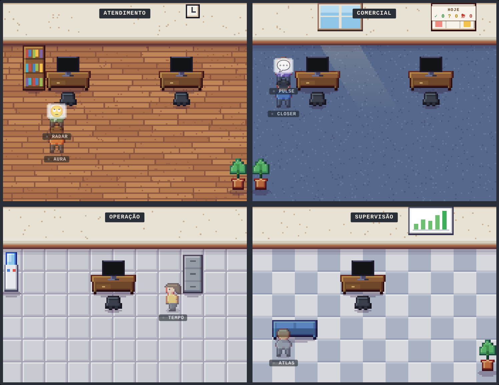
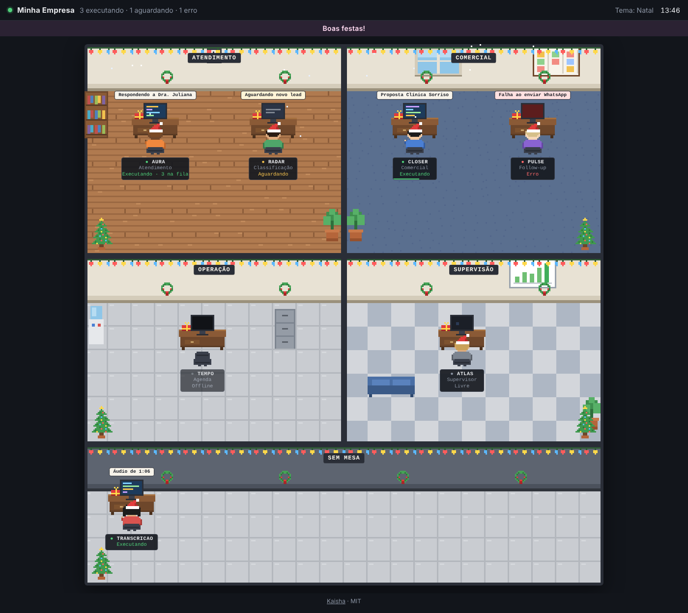
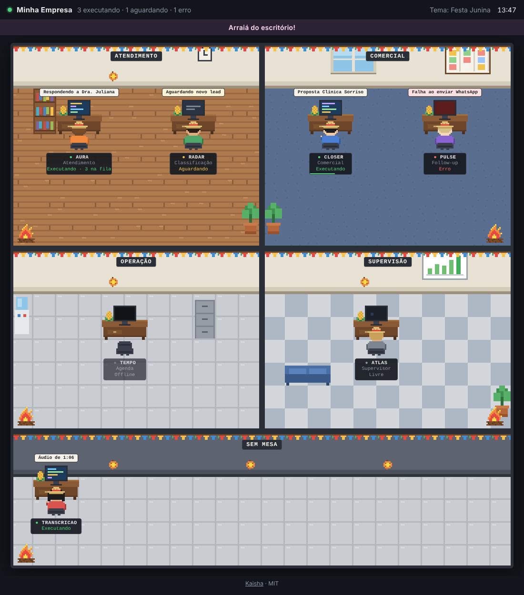

# Kaisha 会社

**Um escritório em pixel art que mostra seus agentes de IA trabalhando, ao vivo.**
Self-hosted, um container só, sobe no EasyPanel em cinco minutos. Licença MIT.



Cada agente tem uma mesa. Quando ele começa uma tarefa, o boneco digita, o monitor acende e um balão mostra o que está fazendo; esperando, aparece em amarelo; com erro, o monitor fica vermelho. Clique num agente para ver o histórico.

- **Funciona com qualquer coisa** que faça uma chamada HTTP: n8n, scripts, cron, Claude Code, OpenClaw, seu backend.
- **Escritório em um arquivo** (`office.yaml`): salas, mesas, móveis. Salvou, o painel muda na hora, sem recarregar a página.
- **Decoração por data**: Natal, Festa Junina e outras datas mudam o escritório sozinhas. Temas novos são uma pasta com um arquivo de texto.
- **Leve**: Node.js 22, SQLite embutido, sem Redis, sem banco externo. Um volume para os dados.

## Subindo no EasyPanel

1. **Crie o app**: em um projeto, *+ Serviço → App*. Em *Fonte*, escolha **Imagem Docker** e use `ghcr.io/nef-producoes/kaisha:latest`.
   (Ou escolha **GitHub**, aponte para este repositório e deixe o *Dockerfile* como método de build.)
2. **Volume**: em *Montagens*, adicione um **Volume** com caminho de montagem `/data`.
3. **Ambiente**:
   ```env
   KAISHA_API_KEY=um-token-longo-e-aleatorio
   # VIEW_PASSWORD=senha-para-ver-o-painel   (opcional)
   TZ=America/Sao_Paulo
   # KAISHA_EXAMPLE=musashi   (opcional: qual exemplo de examples/ vira o primeiro office.yaml)
   ```
4. **Domínio**: em *Domínios*, aponte o seu domínio para a **porta 3000** com HTTPS.
5. **Implante** e abra o domínio. No primeiro acesso o Kaisha cria um `office.yaml` de exemplo dentro do volume.

Para editar o escritório, abra o `office.yaml` do volume (pelo *Console* do EasyPanel ou pelo gerenciador de arquivos) e salve. O painel atualiza sozinho.

### Sem EasyPanel

```bash
docker run -d --name kaisha -p 3000:3000 -v kaisha-data:/data \
  -e KAISHA_API_KEY=um-token-longo ghcr.io/nef-producoes/kaisha:latest
```
ou `docker compose up -d` com o [`docker-compose.yml`](docker-compose.yml).

## Mandando status

```bash
curl -X POST https://kaisha.seudominio.com/api/events \
  -H "apikey: $KAISHA_API_KEY" -H "content-type: application/json" \
  -d '{"agent":"atendimento","status":"working","task":"Respondendo a Maria","queue":3}'
```

| Campo | Obrigatório | O que é |
| --- | --- | --- |
| `agent` | sim | id do agente (o mesmo do `office.yaml`) |
| `status` | sim | `working`, `waiting`, `idle`, `error` ou `offline` |
| `task` | não | texto curto mostrado no balão |
| `queue` | não | itens na fila ("3 na fila") |
| `progress` | não | barra de progresso de 0 a 1 |
| `meta` | não | objeto livre, aparece no histórico |

A autenticação é o header `apikey`, no mesmo padrão da Evolution API. Um agente que não está no `office.yaml` aparece na sala **Sem mesa**. Sem sinal por 15 minutos (`OFFLINE_AFTER`), o agente vira *offline* sozinho; em tarefas longas, mande `POST /api/heartbeat`.

Mais exemplos em [`examples/curl.md`](examples/curl.md). Para o n8n há um subworkflow pronto em [`examples/n8n`](examples/n8n).

## O escritório (`office.yaml`)

```yaml
nome: Minha Empresa
tema: auto              # auto (pelo calendário), natal, junina… ou nenhum
salas:
  - id: atendimento
    nome: Atendimento
    area: [0, 0, 11, 9]   # coluna, linha, largura, altura (blocos de 16 px)
    piso: madeira         # madeira, carpete_azul, carpete_verde, ladrilho, xadrez
agentes:
  - id: atendimento
    nome: Aura
    cargo: Atendimento
    sala: atendimento
    mesa: [2, 3]
    cor: laranja
moveis:
  - { tipo: planta, pos: [10, 7] }
datas_especiais:
  - { data: "03-15", nome: "Aniversário da empresa", mensagem: "Parabéns, equipe!" }
```

As chaves podem ser em português ou inglês (`salas`/`rooms`, `agentes`/`agents`…). Um arquivo com erro não derruba nada: o escritório anterior continua e o erro aparece num aviso na tela. Exemplo completo e comentado em [`examples/office.yaml`](examples/office.yaml).

**Móveis**: `estante`, `planta`, `relogio`, `janela`, `quadro` (kanban), `grafico`, `bebedouro`, `arquivo`, `sofa`, `mesa_reuniao`, `impressora`, `tapete`, `cafe`.
**Cores dos bonecos**: `vermelho`, `laranja`, `amarelo`, `verde`, `azul`, `roxo`, `rosa`, `cinza`, `preto`, `branco`.

## Temas por data

| Tema | Período | | |
| --- | --- | --- | --- |
| Natal | 1 a 26 de dezembro |  | luzinhas, guirlandas, árvore, presentes, gorro e neve |
| Festa Junina | 1º de junho a 31 de julho |  | bandeirinhas, lanternas, fogueira, milho e chapéu de palha |

Datas móveis (Carnaval, Páscoa, Black Friday) são calculadas a cada ano. Para criar um tema, veja o [CONTRIBUTING](CONTRIBUTING.md): é uma pasta com um `theme.yaml`, e os desenhos são texto. Temas próprios podem ficar em `/data/themes/` sem mexer na imagem.

## Variáveis de ambiente

| Variável | Padrão | O que faz |
| --- | --- | --- |
| `KAISHA_API_KEY` | (obrigatória) | token dos agentes, enviado no header `apikey` |
| `KAISHA_API_KEY_HEADER` | `apikey` | nome do header, se quiser outro |
| `VIEW_PASSWORD` | vazio | senha para ver o painel; vazio = aberto |
| `OFFLINE_AFTER` | `15m` | tempo sem sinal até virar offline |
| `HISTORY_DAYS` | `30` | dias de histórico guardados |
| `TZ` | `America/Sao_Paulo` | fuso dos temas e horários |
| `KAISHA_LANG` | `pt-BR` | idioma da interface (`pt-BR` ou `en`) |
| `PORT` | `3000` | porta HTTP |

**Segurança**: o painel mostra as tarefas dos agentes, que podem conter nomes de clientes. Se o domínio for público, use `VIEW_PASSWORD` ou um proxy com login (Cloudflare Access, por exemplo). A `apikey` só permite escrever status.

## API

| Rota | Acesso | |
| --- | --- | --- |
| `POST /api/events` | apikey | um evento, uma lista, ou `{ "events": [...] }` (até 100) |
| `POST /api/heartbeat` | apikey | `{ "agent": "id" }` ou `{ "agents": [...] }` |
| `DELETE /api/agents/:id` | apikey | tira o agente do escritório |
| `POST /api/reload` | apikey | força a releitura do `office.yaml` |
| `GET /api/state` | painel | estado de todos os agentes + escritório + tema |
| `GET /api/agents/:id/history` | painel | últimos eventos (`?limit=50`) |
| `GET /api/stream` | painel | atualizações ao vivo (Server-Sent Events) |
| `GET /healthz` | livre | verificação de saúde |

## Desenvolvimento

```bash
npm install
npm run dev     # http://localhost:3000, dados em ./data, apikey "dev"
```

Sem build: o servidor é Node puro e a página é JavaScript em módulos. Os desenhos são feitos em código ([`web/sprites.js`](web/sprites.js)) e nos temas.

## Licença

[MIT](LICENSE). Código e desenhos podem ser usados, modificados e vendidos à vontade.

---

*Kaisha (会社) é "empresa" em japonês. Feito pela [NEF Produções](https://nefproducoes.com.br).* · [English](README.en.md)
